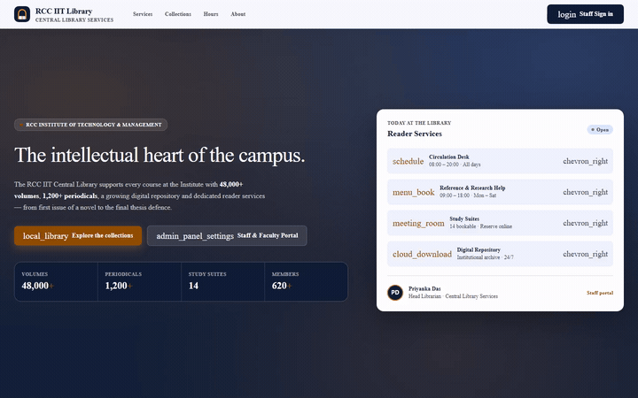

# TaskFlow API — RCC IIT Central Library Services

> A production-grade RESTful backend for **RCC IIT Library**, built with Node.js and Express.
> It powers a complete library management system: a public landing site, a staff sign-in
> portal, and four live operational dashboards — all backed by one API.

**TaskFlow API** is the server-side engine for the *TaskFlow Lite* client. It replaces
browser `localStorage` with real server-side persistence and layers a proper Express
middleware pipeline (CORS, security headers, request logging, rate limiting, schema
validation, centralised error handling) around a clean, resource-oriented REST interface.

---

## Table of Contents

1. [What this project is](#1-what-this-project-is)
2. [Features](#2-features)
3. [Tech stack](#3-tech-stack)
4. [Architecture](#4-architecture)
5. [Getting started](#5-getting-started)
6. [Running the project](#6-running-the-project)
7. [Demo accounts](#7-demo-accounts)
8. [Project structure](#8-project-structure)
9. [API reference](#9-api-reference)
10. [The backend and the database](#10-the-backend-and-the-database)
11. [Demo video](#11-demo-video)
12. [Testing](#12-testing)
13. [Security](#13-security)
14. [Deployment](#14-deployment)
15. [Troubleshooting](#15-troubleshooting)
16. [Roadmap](#16-roadmap)
17. [Skills demonstrated](#17-skills-demonstrated)

---

## 1. What this project is

A **library management backend** for the RCC Institute of Technology & Management,
presented as the "Central Library Services" portal.

It has three audiences:

| Audience | Entry point | What they get |
|---|---|---|
| **Visitors / students** | `/` | A public landing page — services, collections, opening hours, and how to reach the desk |
| **Library staff** | `/login` → `/dashboard` | Four operational dashboards with live, server-backed data |
| **Developers** | `/api/docs` | A fully documented REST API with OpenAPI/Swagger UI |

The interesting part is the middle one: the four dashboard pages started life as static
HTML mock-ups with hard-coded tables. In this build every row of every table is mirrored
to a real server-side task, so **completing a task in the browser changes the store**,
survives a refresh, and is visible from any other device.

### The user journey

```
   ┌──────────────────────────┐
   │  LANDING PAGE  "/"       │   Hero, services, collections, hours, about.
   │  public                   │   "Staff Sign in" CTA.
   └────────────┬─────────────┘
                │
                ▼
   ┌──────────────────────────┐
   │  LOGIN PAGE  "/login"    │   Split screen, demo credential chips,
   │  public                   │   show/hide password, ?next= redirect.
   └────────────┬─────────────┘
                │  POST /api/auth/login → HttpOnly session cookie
                ▼
   ┌──────────────────────────┐
   │  DASHBOARD  "/dashboard" │   4 live dashboards, 141 working buttons,
   │  protected               │   Task Desk panel, session-aware header.
   └──────────────────────────┘
```

---

## 2. Features

### API layer

- **RESTful CRUD** for the task resource with correct status codes (`200`, `201`, `204`, `400`, `404`, `429`, `500`)
- **Consistent response envelope** — `{ success, data }` on success, `{ success, error: { message, details } }` on failure
- **Input validation** with Zod schemas (type, length, required fields) returning field-level errors
- **Input sanitisation** — control characters and HTML tags stripped, preventing stored XSS
- **Query filters** — `?completed=true|false` and `?search=…`
- **Aggregate stats** — `GET /api/stats` groups counters by queue
- **API versioning** — the same endpoints under `/api/tasks` and `/api/v1/tasks`
- **Request ids** — every response carries `X-Request-Id`, repeated in error bodies

### Middleware pipeline

```
Request
   │
   ├─ helmet()              Security headers (CSP, HSTS, frame options, …)
   ├─ securityHeaders       Explicit X-Content-Type-Options, X-Frame-Options, HSTS
   ├─ cors()                Cross-origin headers + preflight
   ├─ requestLogger         Assigns X-Request-Id, logs method/url/status/duration
   ├─ morgan('dev')         Compact request log
   ├─ express.json()        JSON body parsing (100 kB limit)
   ├─ rateLimiter           100 req / 15 min (writes get their own budget)
   ├─ validate(schema)      Zod validation → 400 with field-level details
   ├─ auth guards           Session attach / page redirect / API 401
   ├─ routes                Controllers → services → store
   ├─ notFoundHandler       No route matched → 404
   └─ errorHandler          Anything thrown → normalised JSON error
Response
```

### Authentication

- Server-side sessions with an **HttpOnly**, `SameSite=Lax` cookie
- Session id is 32 bytes of CSPRNG output — unguessable and opaque
- Passwords hashed with **scrypt** and a per-user random salt
- **Constant-time** password comparison, plus a dummy hash for unknown users so
  response time cannot be used to enumerate accounts
- **Account lockout** after 5 failed attempts + a rate limit on the login endpoint
- Password hashes and salts are **never** returned by any endpoint

### The merged frontend

Four dashboards, each bound to the API:

| Page | Dashboard | Queue |
|---|---|---|
| `/dashboard` | Catalog & Resource Inventory | `Catalog` |
| `/dashboard/pages/page1.html` | Overview & Circulation Analytics | `Circulation` |
| `/dashboard/pages/page2.html` | Borrowers & Circulation Services | `Borrowers` |
| `/dashboard/pages/page3.html` | Acquisitions & Order Management | `Acquisitions` |

- Every table row is mirrored to a server-side task (namespaced by queue)
- Live `Open` / `Cleared` chips in the Status column, toggle buttons in the Actions column
- A collapsible **Live Task Desk** panel with full CRUD and live counters
- **141 buttons, all wired** — anything that changes data calls the API
- Sidebar navigation is wired to the real pages, with the current page highlighted
- Auto-refresh every 15 s so changes made elsewhere appear without a reload

### Demo recording

A walkthrough of the whole flow lives at `docs/demo.mp4` and is embedded in
[§11](#11-demo-video).

---

## 3. Tech stack

| Layer | Technology | Why |
|---|---|---|
| Runtime | Node.js ≥ 18 (developed on 24) | LTS, built-in test runner |
| Framework | Express 4 | Router, middleware pipeline, error handling |
| Security | helmet, cors | Standard headers + cross-origin policy |
| Logging | morgan | Compact HTTP request logs |
| Validation | zod | Schema-based validation with typed errors |
| Auth | `node:crypto` (scrypt, random session ids) | No extra dependency, audited primitives |
| Testing | `node:test`, supertest, newman | Zero-config unit + integration, real HTTP collection |
| Load testing | artillery | Scenario-based load profiles |
| Docs | OpenAPI 3.0 + Swagger UI | Machine-readable contract |

**Dependencies:** `express`, `cors`, `morgan`, `helmet`, `zod`, `express-rate-limit`, `dotenv`
**Dev dependencies:** `supertest`, `newman`, `js-yaml`

---

## 4. Architecture

```
┌─────────────────────────────┐
│  Browser                    │
│  landing · login            │
│  4 dashboards · task desk   │
└──────────────┬──────────────┘
               │ fetch (same-origin)
               ▼
┌──────────────────────────────────────────────┐
│  TaskFlow API  (Node.js / Express)           │
│                                              │
│  ┌──────────┐  ┌────────────┐  ┌──────────┐  │
│  │ Routes   │→ │Controllers │→ │ Services │  │
│  └──────────┘  └────────────┘  └────┬─────┘  │
│                                      │        │
│  ┌──────────┐  ┌────────────┐  ┌────▼─────┐  │
│  │Middleware│  │  Models    │  │  Store   │  │
│  │ (6 files) │  │  (zod)     │  │ (memory) │  │
│  └──────────┘  └────────────┘  └──────────┘  │
└──────────────────────────────────────────────┘
```

**Layering rule:** `route → controller → service → store`.
Controllers never touch the store directly, and the store knows nothing about HTTP.
Swapping the in-memory store for MongoDB or PostgreSQL touches **two files only**.

---

## 5. Getting started

### Requirements

- **Node.js 18 or newer** (check with `node -v`)
- **npm 9 or newer**

### Install

```bash
cd taskflow-api
npm install
```

That is the whole setup — there is no database to provision and no build step.

---

## 6. Running the project

### Development (auto-restart on save)

```bash
npm run dev
```

### Production-style

```bash
npm start
```

The server listens on **http://localhost:5000** by default.

### Other commands

| Command | What it does |
|---|---|
| `npm test` | Runs the full suite (88 tests across 2 files) |
| `npm run test:coverage` | Same, with a coverage report |
| `npm run test:postman` | Runs the Postman collection headlessly via Newman |
| `npm run build:pages` | Rebuilds `public/*.html` from `tools/templates/` |
| `npm run audit:buttons` | Prints every button on every page |
| `npm run check:readme` | Validates the Markdown, links and TOC anchors |
| `npm run validate:openapi` | Parses `docs/openapi.yaml` and checks every `$ref` |

### Changing the port

```bash
# Windows
set PORT=8080 && npm start

# macOS / Linux
PORT=8080 npm start
```

Or edit `PORT` in `.env`.

### First things to try

1. Open <http://localhost:5000> — the public landing page
2. Click **Staff Sign in** → use the `priyanka` chip → you land on the dashboard
3. Toggle a task in any table → the chip flips and the count updates
4. Open the **Live Task Desk** panel (bottom right) → add a task → it appears in the table
5. Open <http://localhost:5000/api/docs> — the Swagger UI for the whole API
6. Watch the [demo recording](#11-demo-video)

---

## 7. Demo accounts

Seeded in `src/store/userStore.js` — passwords are hashed with scrypt at boot.

| Username | Password | Role | Department |
|---|---|---|---|
| `priyanka` | `rccit@2026` | Head Librarian | Central Library Services |
| `rccit.desk` | `desk@2026` | Desk Assistant | Reader Services |

Both appear as clickable chips on the login page — one click fills the form.

> In production these are replaced by the real staff directory (Task 4).

---

## 8. Project structure

```
taskflow-api/
├── server.js                     Entry point - boots the HTTP server
├── package.json
├── .env / .env.example           Configuration
│
├── public/                       The merged frontend (served by the API)
│   ├── landing.html              Public landing page
│   ├── login.html                Public sign-in page
│   ├── dashboard/                Protected - requires a session
│   │   ├── index.html            Catalog & Resource Inventory
│   │   └── pages/
│   │       ├── page1.html        Overview & Circulation Analytics
│   │       ├── page2.html        Borrowers & Circulation Services
│   │       └── page3.html        Acquisitions & Order Management
│   └── js/
│       ├── taskflow-api.js       API client (fetch wrapper)
│       ├── taskflow-ui.js        Row ↔ task binding + Live Task Desk
│       ├── dashboard-actions.js  Button action layer (all 141 controls)
│       └── auth.js               Login / session helpers
│
├── src/
│   ├── app.js                    Express app factory (middleware pipeline)
│   ├── config/env.js             Validated environment configuration
│   ├── routes/
│   │   ├── index.js              Route mounting, versioning, health, stats
│   │   ├── taskRoutes.js         Task CRUD endpoints
│   │   ├── authRoutes.js         Login / logout / session
│   │   └── docsRoutes.js         Swagger UI + OpenAPI spec
│   ├── controllers/              HTTP layer (status codes + envelopes)
│   │   ├── taskController.js
│   │   └── authController.js
│   ├── services/                 Business logic
│   │   ├── taskService.js
│   │   └── authService.js
│   ├── models/taskSchema.js      Zod validation schemas
│   ├── middleware/
│   │   ├── auth.js               Session attach + route guards
│   │   ├── security.js           Custom security headers
│   │   ├── logger.js             Request id + morgan
│   │   ├── rateLimiter.js        General + write limiters
│   │   ├── validate.js           Zod validation middleware
│   │   └── errorHandler.js       404 + centralised error handling
│   ├── store/                    Persistence (swap for a DB in Task 4)
│   │   ├── taskStore.js          In-memory task store
│   │   ├── userStore.js          Staff directory (scrypt-hashed passwords)
│   │   └── sessionStore.js       Server-side sessions
│   └── utils/
│       ├── ApiError.js           Operational error with an HTTP status
│       ├── asyncHandler.js       Async route wrapper
│       ├── namespace.js          [Namespace] tag helpers
│       └── sanitize.js           Input sanitisation + id parsing
│
├── tests/
│   ├── api.test.js               Endpoint validation (node:test + supertest)
│   ├── e2e.test.js               Buttons → API → server state
│   ├── postman/                  Postman collection + Newman runner
│   └── load/artillery.yml        Load-test profile
│
├── tools/                        Build + inspection scripts
│   ├── templates/                Landing + login page templates
│   ├── build-pages.js            Injects the shared Tailwind theme
│   ├── rebuild-headers.js        Rebuilds the dashboard header command bars
│   ├── audit-buttons.js          Button inventory
│   ├── check-readme.js           Markdown / link / anchor validator
│   ├── compress-demo.py          Re-encode the recording under GitHub's preview limit
│   ├── make-thumbnail.py         Extracts the demo poster frame from the video
│   └── validate-openapi.js       OpenAPI parser + $ref checker
│
├── docs/
│   ├── openapi.yaml              OpenAPI 3.0 specification
│   ├── demo.mp4                  The demo recording embedded in this README
│   └── thumbnail.jpg             Poster frame for the recording
└── README.md
```

---

## 9. API reference

### Tasks

| Method | Endpoint | Description | Status |
|---|---|---|---|
| `GET` | `/api/tasks` | Get all tasks (newest first) | 200 |
| `GET` | `/api/tasks/:id` | Get a single task | 200, 404 |
| `POST` | `/api/tasks` | Create a task | 201, 400 |
| `PUT` | `/api/tasks/:id` | Update a task (partial) | 200, 400, 404 |
| `PATCH` | `/api/tasks/:id` | Alias of PUT | 200, 400, 404 |
| `DELETE` | `/api/tasks/:id` | Delete a task | 204, 404 |

Also available under `/api/v1/tasks`.

**Query parameters** — `completed=true|false`, `search=<substring>`.

**Task resource**

```json
{
  "id": 1,
  "text": "Buy groceries",
  "completed": false,
  "createdAt": "2026-01-15T10:30:00.000Z",
  "updatedAt": "2026-01-15T10:30:00.000Z"
}
```

**Create** — `text` is required (1–255 chars, trimmed, HTML stripped); `completed` is
optional and defaults to `false`.

**Update** — send only what you want to change. At least one of `text` or `completed`
must be present, otherwise the request is rejected with `400`.

### Authentication

| Method | Endpoint | Description | Status |
|---|---|---|---|
| `POST` | `/api/auth/login` | Start a session | 200, 400, 401, 429 |
| `POST` | `/api/auth/logout` | End the session | 200 |
| `GET` | `/api/auth/session` | Current user | 200 |

### Other

| Method | Endpoint | Description |
|---|---|---|
| `GET` | `/api/stats` | Aggregate counters grouped by queue |
| `GET` | `/api/health` | Service liveness probe |
| `GET` | `/api/docs` | Swagger UI |
| `GET` | `/api/openapi.yaml` | OpenAPI specification |
| `GET` | `/docs/demo.mp4` | The demo recording |

### Quick examples

```bash
# Create
curl -X POST http://localhost:5000/api/tasks \
     -H "Content-Type: application/json" \
     -d '{"text":"Return received · Principles of Neural Science"}'

# Read
curl http://localhost:5000/api/tasks

# Update
curl -X PUT http://localhost:5000/api/tasks/1 \
     -H "Content-Type: application/json" \
     -d '{"completed":true}'

# Delete
curl -X DELETE http://localhost:5000/api/tasks/1

# Sign in (keep the cookie)
curl -c cookies.txt -X POST http://localhost:5000/api/auth/login \
     -H "Content-Type: application/json" \
     -d '{"username":"priyanka","password":"rccit@2026"}'

# Reach a protected page
curl -b cookies.txt http://localhost:5000/dashboard
```

---

## 10. The backend and the database

### The short answer

**Yes, the backend works end to end** — every button, form and panel writes to the
server and reads back from it. But TaskFlow currently persists to **memory**, not to a
database, because the brief for this task was explicitly:

> *In-Memory Data Store (transition to DB in next task)*

### What that means in practice

| Store | Location | Survives a restart? | Swap cost |
|---|---|---|---|
| Tasks | `src/store/taskStore.js` (array) | ❌ | ~2 files |
| Staff | `src/store/userStore.js` (array) | ❌ | ~2 files |
| Sessions | `src/store/sessionStore.js` (Map) | ❌ | ~2 files |

So: **restarting the server clears the tasks and signs everyone out.** That is
by design for this task, not a bug.

### How to move to a real database (Task 4)

The stores are deliberately isolated behind small classes with a fixed method surface,
so the migration touches two files:

1. **`src/store/taskStore.js`** — replace the array with a Mongoose model or a `pg`
   repository, keeping the same method names: `all()`, `find(id)`, `create(payload)`,
   `update(id, patch)`, `remove(id)`, `clear()`.

2. **`src/services/taskService.js`** — `await` the now-asynchronous store calls.

Nothing in the controllers, routes, middleware, frontend or tests changes, because the
HTTP contract stays identical.

For sessions, move `sessionStore` to Redis (or a `sessions` table) so logins survive
restarts and scale across instances.

---

## 11. Demo video

A walkthrough of the whole flow — the landing page, the staff sign-in, the live
dashboards and the task desk.



> The preview plays right here in the README — no download, no extra clicks.
>
> **Why a GIF?** GitHub's file viewer does not render a video player for MP4, and
> `raw.githubusercontent.com` serves repository MP4s as `application/octet-stream`,
> so the browser downloads the file instead of playing it. An animated GIF is the only
> format GitHub renders natively inside a README.
>
> The GIF is generated from `docs/demo.mp4`; the poster frame lives at
> `docs/thumbnail.jpg`. To publish a new recording:
>
> ```bash
> python tools/compress-demo.py    # shrink the mp4 under GitHub's preview limit
> python tools/make-demo-gif.py    # rebuild the inline preview
> python tools/make-thumbnail.py   # refresh the poster frame
> ```

### How the demo preview is built

The whole pipeline is reproducible — four scripts, no manual steps.

| # | Script | What it does |
|---|---|---|
| 1 | `tools/record-demo.py` | Launches **headless Chrome** and drives it over the **Chrome DevTools Protocol**. It walks the real user journey — landing → services → collections → sign-in → dashboard → task cleared → task desk → borrowers → Swagger — clicking and typing through `Runtime.evaluate`, capturing a burst of frames per step with `Page.captureScreenshot`. |
| 2 | `tools/compress-demo.py` | Re-encodes the capture to **H.264 / 960px / CRF 30** with `+faststart`, so the `moov` atom sits at the front and playback starts instantly. |
| 3 | `tools/make-demo-gif.py` | Builds an **animated GIF** with ffmpeg's `palettegen` + `paletteuse` (Bayer dithering, 16-colour adaptive palette) at 6 fps. |
| 4 | `tools/make-thumbnail.py` | Samples 10 frames from the clip and keeps the one with the highest pixel variance, so the poster is never a black frame or a blank transition. |

Two guards worth knowing about:

- **Size** — GitHub will not preview a file above its blob-view limit and shows
  *"Sorry about that, but we can't show files that are this big right now."*
  Step 2 keeps the MP4 well under it.
- **Format** — GitHub's file viewer renders **no video player for MP4** (verified
  against a known-good control file), and `raw.githubusercontent.com` serves
  repository MP4s as `application/octet-stream`, which makes the browser
  *download* the file instead of playing it. An animated GIF is the only format
  GitHub renders natively inside a README — so that is what the embed points at.

`npm run check:demo` verifies the whole chain: the embed points at a real GIF, the
GIF header is valid, no download link or `<video>` tag survived, and every asset
resolves.

---
### What to record

| # | Scene | Shows off |
|---|---|---|
| 1 | The landing page | The public site and the "Staff Sign in" entry point |
| 2 | Signing in with the demo chip | Session cookie, redirect to `?next=` |
| 3 | A dashboard table row toggled | The chip flipping and the count updating live |
| 4 | The Live Task Desk panel | Creating, completing and deleting a real task |
| 5 | The API docs | The documented contract behind all of it |

---

## 12. Testing

```bash
npm test              # 88 tests, 2 files
npm run test:coverage
npm run test:postman # 29 requests, 71 assertions, headless
```

### What is covered

| Suite | File | Tests | Focus |
|---|---|---|---|
| Endpoint validation | `tests/api.test.js` | 73 | Every endpoint, every status code, edge cases, auth flows, security headers, rate limiting |
| End-to-end | `tests/e2e.test.js` | 15 | Buttons → API → server state |
| Postman collection | `tests/postman/` | 29 requests | The same contract from a client perspective |

### Notable cases

- XSS payload `<script>alert(1)</script>` is sanitised before storage
- Malformed JSON → `400`, not `500`
- `?id=abc` and `?id=-5` → `404`, not a crash
- Unknown user and wrong password return the **identical** message and take the same time
- A password hash never appears in a response body
- An unauthenticated visitor to `/dashboard` is redirected with the intended path preserved
- A bulk button creates exactly one task per visible row
- A CSV export returns every task the server holds

### Load testing

```bash
# Quick smoke test
npx artillery quick --count 50 -n 20 http://localhost:5000/api/tasks

# Full profile (warm-up → steady → stress → recovery)
npx artillery run tests/load/artillery.yml
```

The profile asserts `p99 < 500 ms` and `< 1 %` failed requests.

---

## 13. Security

| Area | Measure |
|---|---|
| Headers | helmet + custom `X-Content-Type-Options`, `X-Frame-Options`, HSTS, `Referrer-Policy`, `Permissions-Policy` |
| Fingerprinting | `X-Powered-By` removed |
| Passwords | scrypt + per-user salt; never logged, never returned |
| Sessions | 32-byte random id, HttpOnly + SameSite=Lax cookie, `Secure` in production |
| Brute force | 5 failed attempts → 10-minute lockout; login rate limit of 20 / 15 min |
| Timing attacks | Constant-time comparison, dummy hash for unknown users |
| Input | Zod validation + HTML/control-character stripping |
| Rate limiting | 100 req / 15 min per IP; writes get their own budget |
| Body size | 100 kB cap on JSON bodies |
| Errors | Production never leaks stack traces or internal messages |
| XSS | Sanitised on the way in; the CSP blocks inline script on API responses |
| Request tracing | Every request gets an id, echoed in logs and error bodies |

---

## 14. Deployment

### Environment

```bash
NODE_ENV=production
PORT=5000
CORS_ORIGIN=https://library.rccit.edu
RATE_LIMIT_MAX=100
WRITE_RATE_LIMIT_MAX=120
SESSION_TTL_MS=28800000
```

### Notes for production

- Put the app behind a reverse proxy (nginx / Caddy) with TLS — the session cookie
  becomes `Secure` automatically when `NODE_ENV=production`
- Run under a process manager: `pm2 start server.js --name taskflow`
- Set `app.set('trust proxy', 1)` (already configured) so the rate limiter sees real IPs
- Move the in-memory stores to a database — see [§10](#10-the-backend-and-the-database)

---

## 15. Troubleshooting

| Symptom | Cause | Fix |
|---|---|---|
| `EADDRINUSE` | Port 5000 is taken | `PORT=5001 npm start`, or stop the other process |
| Login works but the dashboard bounces back to `/login` | Session expired (8 h) or the server restarted | Sign in again — sessions are in memory |
| "Too many write requests" | The dashboard seeds one task per table row on first visit | Raise `WRITE_RATE_LIMIT_MAX`, or wait 15 minutes |
| Tasks vanished after a restart | Expected — the store is in memory | See [§10](#10-the-backend-and-the-database) |
| Page is unstyled | Tailwind CDN blocked | Check the browser console and your network connection |
| Swagger UI is blank | `docs/openapi.yaml` failed to parse | Run `npm run validate:openapi` |
| The demo thumbnail is stale | The video changed | Run `python tools/make-thumbnail.py` |
| `npm run build:pages` changed nothing | The templates were not edited | Edit `tools/templates/*.html`, then rebuild |

---

## 16. Roadmap

| Task | Status | Scope |
|---|---|---|
| **1–2** | ✅ | TaskFlow Lite client with `localStorage` persistence |
| **3** | ✅ | **This project** — the REST API, middleware, tests and merged frontend |
| **4** | ⏭️ | Replace the in-memory stores with MongoDB or PostgreSQL and move sessions to Redis |
| **5** | ⏭️ | Catalogue search with real MARC21 records, patron self-service, fine calculation |

---

## 17. Skills demonstrated

| Area | Evidence |
|---|---|
| **REST API design** | Resource-oriented endpoints, correct HTTP verbs, `201` + `Location`, `204` for deletes, query filters, versioning |
| **Express** | App factory, router, middleware pipeline, centralised error handling, `res.sendFile` for static pages |
| **Middleware** | CORS, morgan logging, request ids, helmet, custom security headers, rate limiting, Zod validation, session guards |
| **HTTP protocols** | Status codes, headers, `Content-Type`, JSON body parsing, range requests, `Accept-Ranges` |
| **Security** | scrypt hashing, constant-time comparison, HttpOnly cookies, account lockout, input sanitisation, CSP |
| **Front-end integration** | Same-origin API client, row ↔ task binding, a 141-button action layer, polling, toasts, drawers, modals |
| **Authentication** | Server-side sessions, login/logout/session endpoints, protected routes, `?next=` redirects, RBAC-ready user model |
| **Testing** | `node:test`, supertest, a 29-request Postman collection run headlessly by Newman, coverage, Artillery load profiles |
| **API documentation** | OpenAPI 3.0, a Swagger UI page, a `$ref` validator |
| **Media handling** | Frame extraction from the demo recording, poster generation, GitHub-compatible embedding |
| **Tooling** | Page templating with a shared design system, header generators, a button auditor, a Markdown/anchor validator |

---

<div align="center">

**RCC IIT Library — Central Library Services**
TaskFlow API · Node.js + Express · REST + Authentication + Live dashboards

</div>
